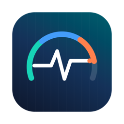
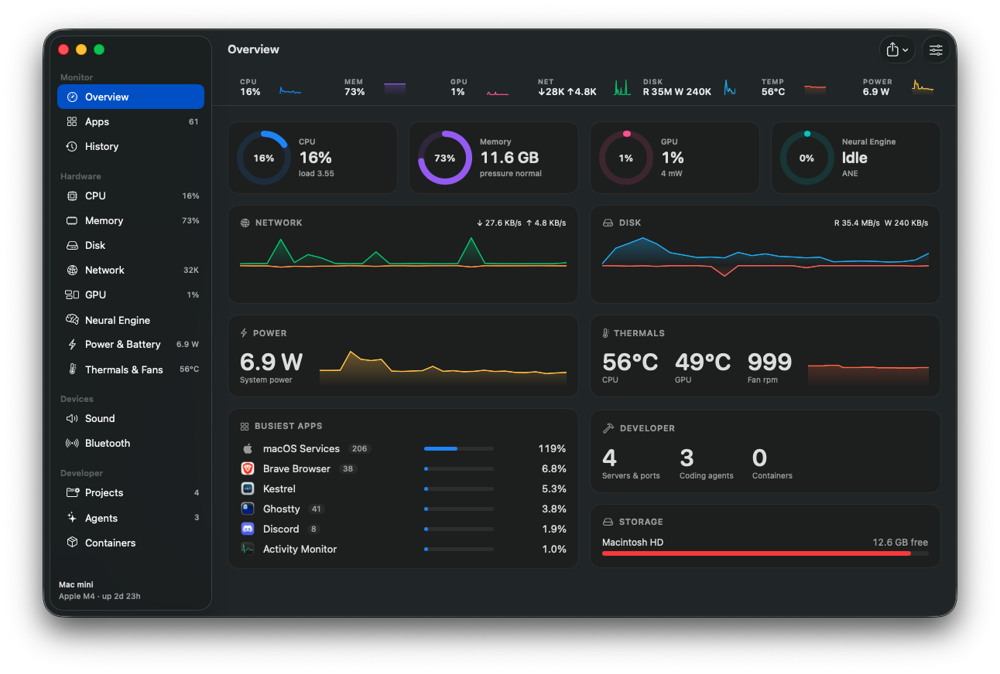
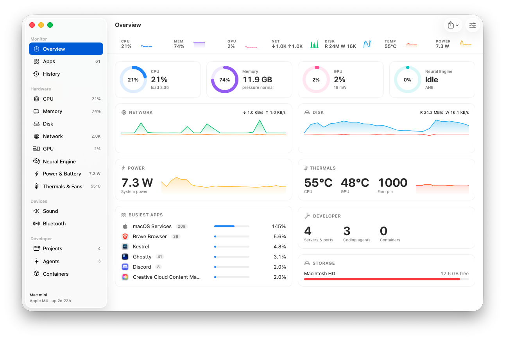
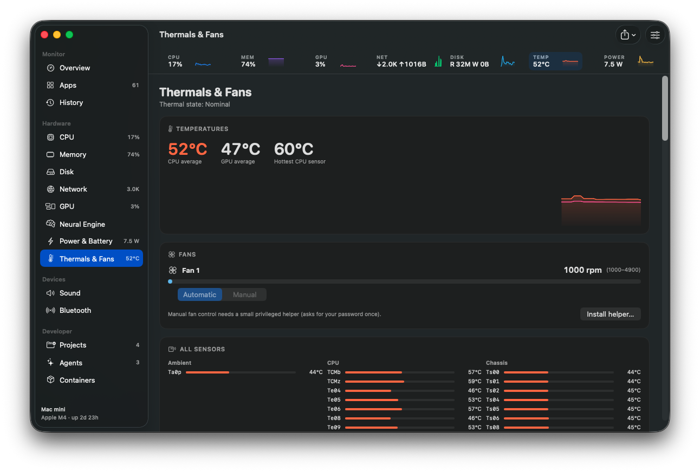
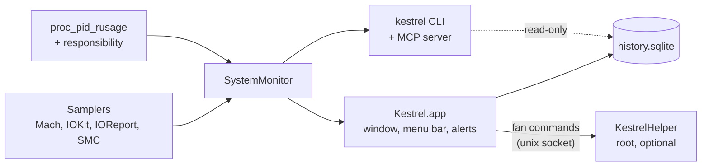

<div align="center">



# Kestrel

**Your Mac at a glance, with the developer stuff built in.**

A native macOS system monitor for the menu bar. CPU, memory, GPU, Neural Engine,
power, temperatures and fans, plus the dev servers, coding agents and containers
that are actually eating your Mac. No Electron, no account, no telemetry.

[](https://github.com/mralifakbar/kestrel/actions/workflows/ci.yml)
[](https://github.com/mralifakbar/kestrel/releases/latest)


[](LICENSE)



</div>

## Features

### Everything about the hardware

- **CPU** — user, system, idle, load averages, and every performance and efficiency core.
- **Memory** — app, wired, compressed, cached, free, swap and memory pressure.
- **GPU and Neural Engine** — utilization, renderer/tiler, GPU memory, ANE power and
  memory read/write traffic, read from Apple silicon's own power counters.
- **Disk** — read/write throughput and operations, free space on every volume.
- **Network** — download/upload in total and per interface, with addresses.
- **Power and battery** — CPU, GPU, ANE and DRAM power, whole-system watts, charge,
  time remaining, power draw, health, cycle count and temperature. It also lists
  what's draining power and what's keeping your Mac awake.
- **Temperatures and fans** — CPU and GPU temperature, every SMC sensor, fan speed,
  and manual fan control through a small optional helper.
- **Sound** — output and microphone volume, device switching, and per-app volume and mute.
- **Bluetooth** — battery levels for keyboards, mice, trackpads and AirPods (left, right, case).

### Apps, not 1,000 processes

Helper processes are folded into the app that launched them, so you see about 60
apps instead of hundreds of processes, each with combined CPU, memory, disk,
network and energy. Click any process for the **Process Inspector**: code signature
(Team ID, hardened runtime, sandbox), parent, launchd agent, full command line, CPU
time split into user and system, memory against its peak, open files, listening
ports and child processes. Copy it, save it as CSV, or get it from `kestrel process`.

### Built for developers

- **Projects** — dev servers and the ports they hold, grouped by project folder.
  Idle servers are flagged and can be stopped in one go. Every stop asks first.
- **Agents** — running Claude Code, Codex, Gemini CLI, Aider, OpenCode, Cursor Agent,
  GitHub Copilot CLI, Amp, Kiro and Goose sessions, whether each is working or
  waiting, and everything it started. Quitting a session quits its whole tree.
- **AI usage limits** — remaining quota, reset times and pace for Claude, Codex,
  Copilot and Cursor, plus tokens used today and this week. Off until you turn it on.
- **Containers** — per-container CPU, memory, network and ports, grouped by Compose
  project, with start/stop/restart.
- **MCP server** — lets Claude, Codex and Cursor ask Kestrel what's going on. Off by
  default, and any request to quit something shows a confirmation in the app.
- **`kestrel` CLI** — `status`, `top`, `ports`, `agents`, `limits`, `process`,
  `containers`, `history`, `stop --idle`, as a table or `--json`.

### Menu bar, alerts and history

- Each reading can be its own menu bar item, as a value, a graph or both. It turns
  red under strain. Click it for every figure and the apps behind it; click an app to
  jump to it. Hold <kbd>⌘</kbd> and drag to reorder.
- Notifications when an app uses a lot of CPU for too long, keeps growing in memory,
  or hammers the disk or network.
- History for every metric and the busiest apps, from the last hour to a year, kept
  in one local SQLite file (30 days, 90 days, 6 months or 1 year).

### Make it yours

Reorder or hide sections in the window and the dropdown. Celsius or Fahrenheit,
bytes or bits, CPU per core or per Mac. Colorful, monochrome or colour-blind-safe
palettes and a compact layout. Export a 1200×630 share image in light or dark, or
copy the dashboard as text. Optional Dock icon. English and Bahasa Indonesia,
following your Mac's language.

<table>
  <tr>
    <td></td>
    <td></td>
  </tr>
  <tr>
    <td align="center"><sub>Light mode</sub></td>
    <td align="center"><sub>Every temperature sensor, fan speed and fan control</sub></td>
  </tr>
</table>

## Install

### Download

1. Grab `Kestrel-x.y.z.zip` from the [latest release](https://github.com/mralifakbar/kestrel/releases/latest).
2. Unzip it and move **Kestrel.app** to `/Applications`.
3. The app is ad-hoc signed, not notarized, so the first time macOS will block it.
   Right-click the app and choose **Open**, or run:

   ```sh
   xattr -dr com.apple.quarantine /Applications/Kestrel.app
   ```

Kestrel lives in the menu bar. Click any reading, then **Open Kestrel** for the window.

### Build from source

Requires macOS 15 or later and Xcode 16 or later.

```sh
git clone https://github.com/mralifakbar/kestrel.git
cd kestrel
./build.sh --install      # builds build/Kestrel.app and copies it to /Applications
```

`./build.sh --universal --zip` builds what releases ship: an arm64 + x86_64 app and
a zip. Set `KESTREL_SIGN_IDENTITY="Apple Development: …"` to sign with your own
certificate, so macOS remembers the audio and notification permissions across rebuilds.

## Command line

Settings › Integrations › **Install `kestrel` command** links the CLI into your
`PATH`. It's also at `Kestrel.app/Contents/Helpers/kestrel`.

```sh
kestrel status               # system overview
kestrel top -n 10 --mem      # apps by memory (add --procs for raw processes)
kestrel ports                # dev servers and listening ports by project
kestrel agents               # coding agents and what they started
kestrel limits               # AI usage limits and tokens
kestrel process 4242 --csv   # inspect one process (pid or name)
kestrel containers           # Docker containers
kestrel history cpu --range 7d
kestrel stop --idle          # quit idle dev servers, after asking
```

Every command takes `--json`.

### MCP server

Turn it on in Settings › Integrations, then add it to your client:

```sh
claude mcp add kestrel -- /Applications/Kestrel.app/Contents/Helpers/kestrel mcp
codex mcp add kestrel -- /Applications/Kestrel.app/Contents/Helpers/kestrel mcp
```

Tools: `get_status`, `get_top_apps`, `get_ports`, `get_agents`, `get_limits`,
`inspect_process`, `get_history`, `get_containers` and `request_stop`. The last one
only asks: the app shows a dialog, and nothing is quit unless you click **Allow**.

## How it works



- **Samplers** (`Sources/KestrelCore`). CPU and memory come from Mach host
  statistics, GPU from the `IOAccelerator` performance statistics, disk from
  `IOBlockStorageDriver`, network from 64-bit interface counters, power and
  Neural Engine from Apple silicon's `IOReport` energy counters, and temperatures
  and fans from the SMC.
- **Apps** (`Processes.swift`). Every process is read with `proc_pid_rusage`, and
  grouped by the process macOS holds *responsible* for it, so helpers land on the
  app that started them. Static facts are cached per process, so a full pass over
  ~400 processes costs a few milliseconds.
- **Dev tools** (`DevTools.swift`, `AIUsage.swift`). Listening sockets come from
  `proc_pidfdinfo`, project folders from each process's working directory, agents
  from their command lines (and Claude Code's own session files), tokens from the
  session logs on disk.
- **Per-app volume** (`AudioController.swift`). A muted Core Audio process tap
  captures one app, and Kestrel plays it back at the chosen gain.
- **Fan helper** (`Sources/KestrelHelper`). See [SECURITY.md](SECURITY.md).

Kestrel samples every 5 seconds with the window closed and every second while it's
open.

## Privacy

No account and no analytics. Kestrel makes no network requests unless you turn on
**AI usage limits**, which call each provider's own usage endpoint with the sign-in
your tools already keep on this Mac. History stays in
`~/Library/Application Support/Kestrel/history.sqlite`.

## Development

```sh
swift build                # debug build
swift test                 # unit tests
./build.sh && open build/Kestrel.app
```

[CONTRIBUTING.md](CONTRIBUTING.md) lists the development switches, including the one
that opens the window on a given section for screenshots.

## Contributing

Bug reports, new agent signatures, sensor names and pull requests are welcome. Start
with [CONTRIBUTING.md](CONTRIBUTING.md). To report a security issue, follow
[SECURITY.md](SECURITY.md) instead of opening an issue.

## License

[MIT](LICENSE) © Alif Akbar Kartadinata
